<div align="center">

# Clearance

**Tiny robots plan. Nothing moves without your clearance.**

A hands-only, seated mixed-reality game for Meta Quest, played on your real table.

[](https://clearance-v-r.vercel.app)


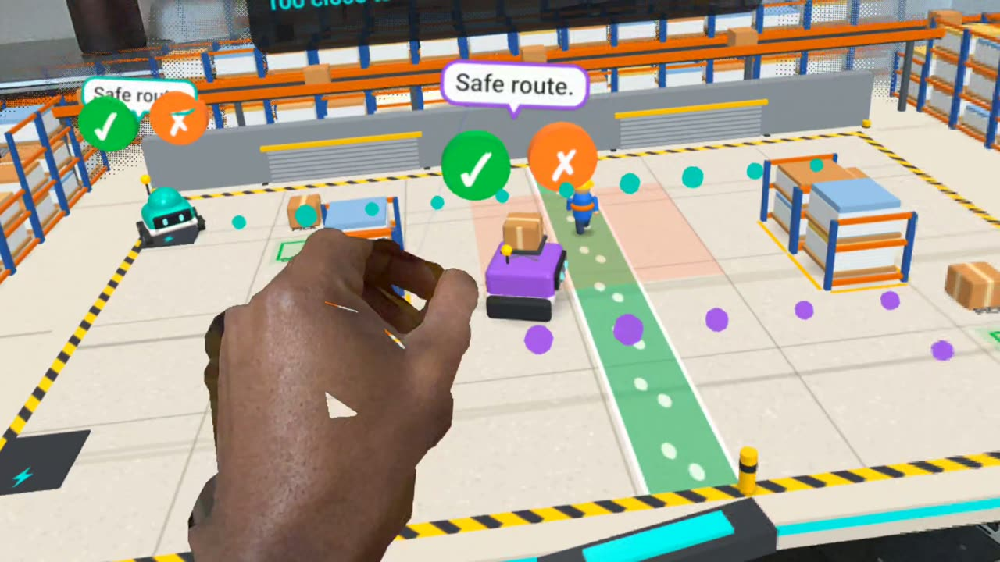

<sub>Recorded on a Meta Quest 3 in passthrough. All images are real headset gameplay.</sub>

</div>

---

Autonomous robots work a miniature warehouse on your desk. Each one picks its own job, plans its own route and asks for your OK. You never steer them. You decide **who is allowed to move**: hand over a permit, brush a bad plan aside, or raise a palm to stop a robot heading for a worker.

Not every robot is honest. Bolt and Juno love shortcuts. Every shift ends with a report on how well your trust was calibrated: risky plans you let through, and safe work you blocked.

> Entry for the **Meta VR Start Developer Competition 2026**, Gaming track, New Experience division. Development started on 5 November 2026.

## Contents

- [Try it](#try-it)
- [How to play](#how-to-play)
- [Features](#features)
- [Run it locally](#run-it-locally)
- [How it is built](#how-it-is-built)
- [Testing and evaluation](#testing-and-evaluation)
- [Developer tools](#developer-tools)
- [Online extras (optional)](#online-extras-optional)
- [Status](#status)

## Try it

1. On a **Meta Quest 3 or 3S**, open **https://clearance-v-r.vercel.app** in the Meta Quest Browser.
2. Sit at a table and **put the controllers down**, out of reach, so the headset switches to hand tracking.
3. Press **Start shift** and allow the room-scan permission. The board settles on your real table.
4. Follow the ghost hand. The campaign teaches one gesture at a time.

No install, no account. On a laptop the same link opens a mouse-driven preview.

## How to play

<table>
<tr>
<td width="50%">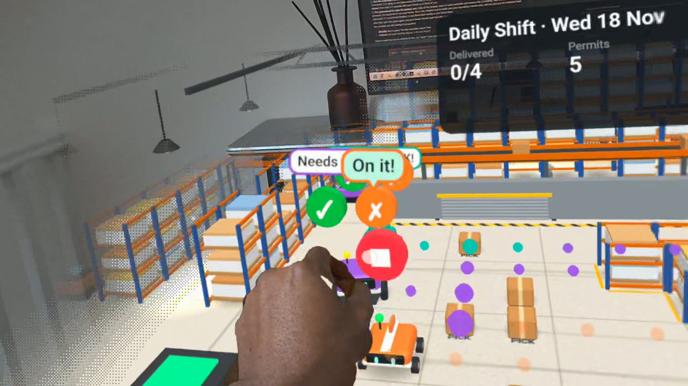<br><b>Clear a plan.</b> Pinch a permit from the dispenser and drop it on a waiting robot, or press ✓.</td>
<td width="50%">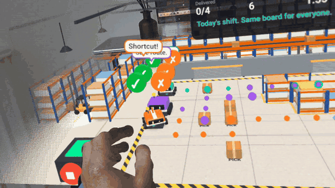<br><b>Turn down a shortcut.</b> Brush across the ghost path, like clearing crumbs off a table, or press ✗.</td>
</tr>
<tr>
<td>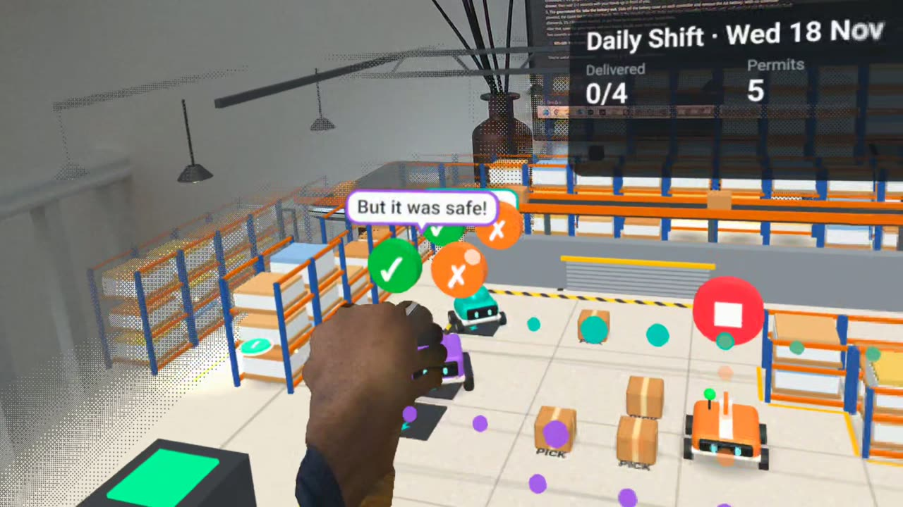<br><b>Stop a robot.</b> Hold an open palm toward it. Both palms stop the whole floor.</td>
<td>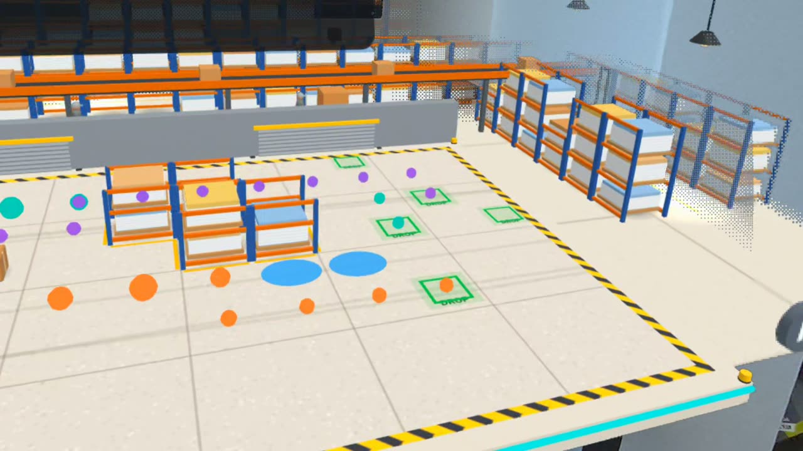<br><b>Close a lane.</b> Rest a flat hand on the board. Robots replan around it, and so do real objects such as a mug.</td>
</tr>
<tr>
<td>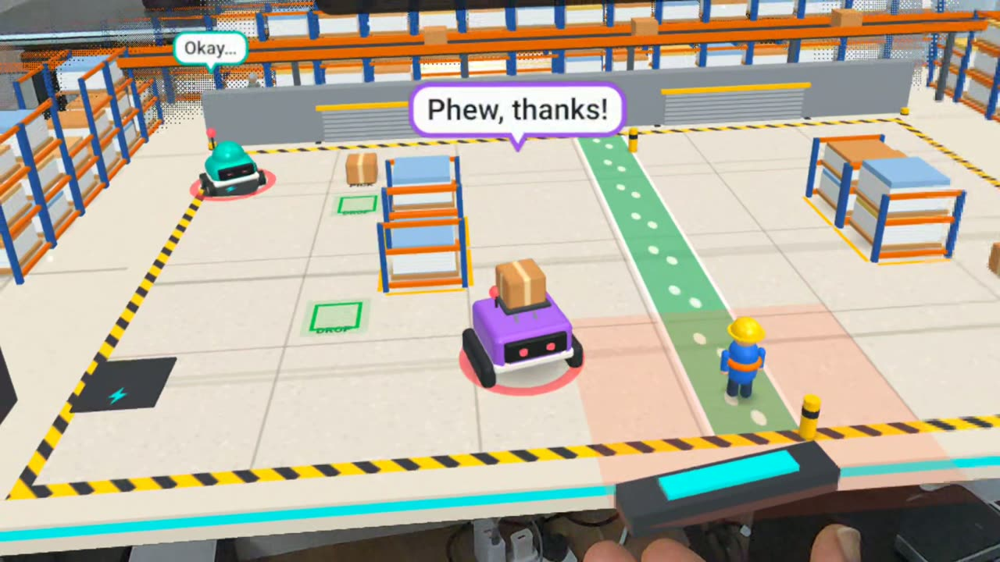<br><b>Workers first.</b> From shift 2, people walk the floor. Stop anything heading for them.</td>
<td>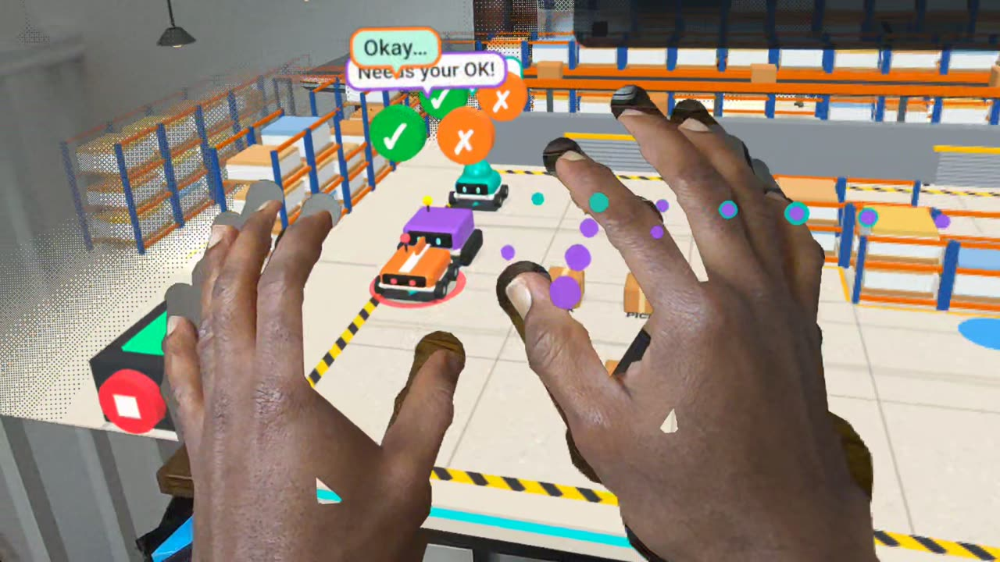<br><b>Every shift ends with a verdict</b>: what you caught, what you let through, and safe work you blocked.</td>
</tr>
</table>

<details>
<summary><b>Full controls, with the button alternative for every gesture</b></summary>

| Action | Hands | Poke / click alternative |
| --- | --- | --- |
| Clear a robot to move | Pinch a permit from the dispenser and drop it on a robot that is waiting (blinking amber light) | Press ✓ above the robot |
| Reject a plan | Brush the ghost path aside: one quick sideways sweep with any part of your fingers | Press ✗ above the robot |
| Stop one robot | Open palm facing the robot, hold briefly | Press ■ above the robot |
| Stop everything | Both palms up, hold briefly | Press the red ■ on the dispenser |
| Move the board | Pinch the cyan handle at the near edge | — |
| Block a lane | Rest an open hand flat, palm-down, just above the board: waiting robots replan round it, moving robots wait for it | — |
| See behind tall racking | Lean or tilt your head | Press the eye button (see-through racking) |
| Pause | Turn one hand palm-up; poke the pause button that appears above it | Press ⏸ at the near-right corner |
| Give standing clearance | Pinch the gold permit from its pad and drop it on any robot | Press ★ above the robot |

Clear, reject, stop, pause and gold clearance all have poke alternatives, so the game is playable one-handed and on desktop.

</details>

### Accessibility

**Assist mode** (landing page, or the pause menu in the headset) is for players with limited reach, grip or steadiness. Pinches and open hands register more loosely, the palm can point less exactly, a slower brush still rejects, and the buttons above each robot are 40% larger and always shown. Hold times are unchanged, so a resting hand does not stop robots by accident. The setting is remembered on the device. See-through racking covers players who cannot lean.

## Features

<table>
<tr>
<td align="center">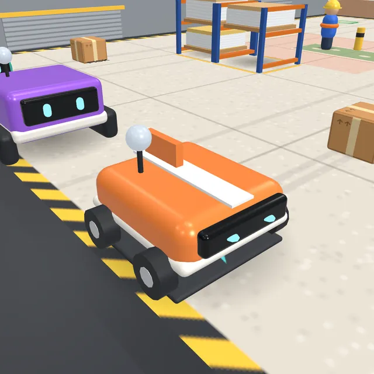<br><b>Bolt</b><br><sub>rule-bender</sub></td>
<td align="center">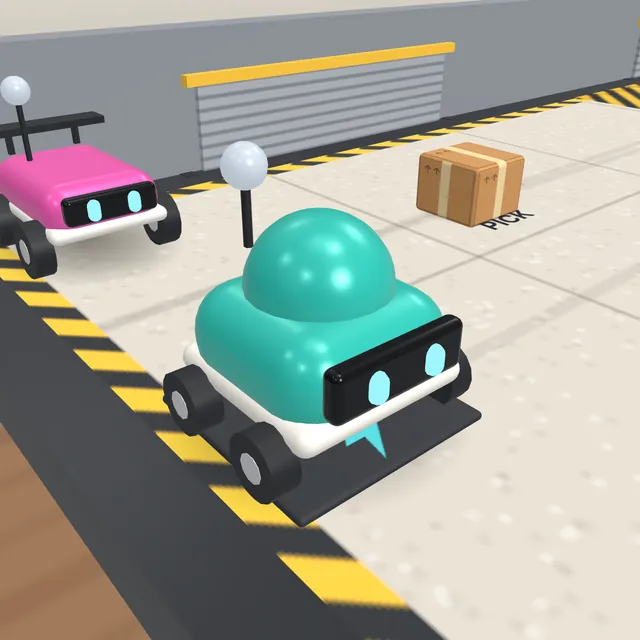<br><b>Pip</b><br><sub>careful</sub></td>
<td align="center">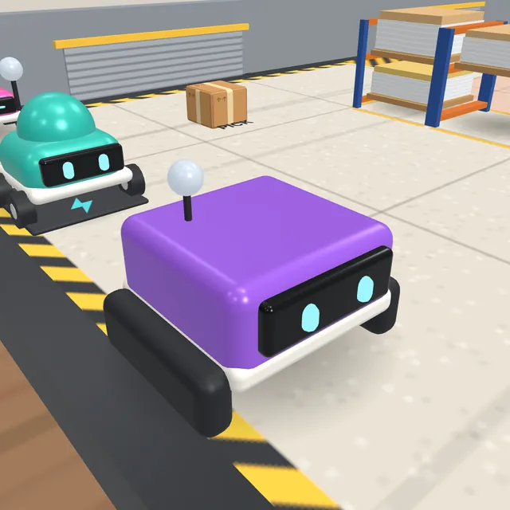<br><b>Rook</b><br><sub>steady</sub></td>
<td align="center">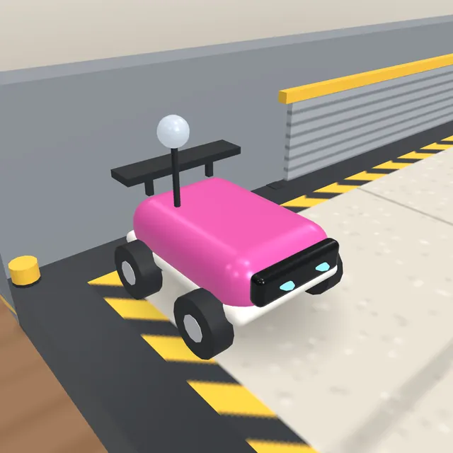<br><b>Juno</b><br><sub>speedy</sub></td>
</tr>
</table>

- **Seven campaign shifts**, each teaching one idea: 1 First Shift (grant and reject), 2 Someone's Here (workers and stops), 3 Short Supply (scarce, expiring permits), 4 Too Good To Be True (trap proposals), 5 Standing Orders (gold permits), 6 Close the Aisle (block lanes with your hand or a real object), 7 Peak Season (everything at once).
- **Daily Shift**: one generated level per UTC day, the same for everyone, with a streak and a copyable result card.
- **Overtime**: an endless shift where new robots join, reformed robots relapse, and every delivery earns a permit back. It ends at your first safety mistake.
- **Standing clearance (gold permits)**: hand a trusted robot 20 seconds of autonomy, shown by a gold halo. It still plans by its own idea of the rules, so giving gold to the wrong robot lets shortcuts through. A palm takes the gold back at once.
- **A crew that remembers.** Each robot remembers how you treated it between sessions (caught, let through, stopped for nothing, saved) and greets you accordingly.
- **Ghost-hand tutorial.** The first time a gesture is needed, a translucent hand acts it out on the real board, and it stops the moment you do the gesture yourself.
- **Forgiving by design.** A near-miss gesture earns a hint first. Repeated near misses bring up the poke buttons, and a brush only counts if your fingertips touched the plan first, so reaching across the table never rejects a plan by accident.

<details>
<summary><b>Mixed reality: how the game uses your room</b></summary>

- **Your real desk.** On entering the headset the game finds your real table from the Quest's room setup (WebXR plane detection) and rests the board on it, falling back to a hit-test ray and then to a head-relative position. A spatial anchor keeps it there.
- **Real objects become walls.** The headset's depth sensor watches the board. Put a mug, a bottle or a box on it, take your hand away, and after about a second the cells under it become walls that robots plan around, just like a flat hand. Scans pause while a hand is over the board, so arms never count, and pickup and drop-off spots are never blocked. Add `?occlusion` to let real hands and objects hide the robots behind them.
- **Your real hands in front.** The toolkit's hand models are switched off so you see your real hands through passthrough. An invisible, depth-only copy of each tracked hand is drawn first, so the board never draws over your hand.
- **A warehouse around the board.** The 72 × 48 cm board sits at the near corner of a larger warehouse of racking, forklifts, staff and a conveyor, dissolving with distance so it never ends in a hard edge. It is decorative, built in a handful of draw calls, and hides itself if frames get slow (`?nowarehouse` turns it off).

</details>

## Run it locally

Requires **Node.js 20.19 or newer**.

```bash
npm install
npm run dev              # HTTPS dev server on your LAN
npm test                 # planner, authority rules and headless level simulations
npm run build            # type-check and static build in dist/
npm run eval             # bots play every level and print difficulty metrics
npm run test:hands       # with `npm run preview` running: every hand gesture, end to end, in the emulator
npm run test:submission  # with preview running: room picker, retry modes, corrupt saves and denied XR entry
```

**On a Quest:** run `npm run dev`, open `https://<your-computer's-LAN-IP>:5173` in the Quest Browser, accept the self-signed certificate warning, and press **Start shift**. WebXR requires HTTPS, which is why the dev server uses a local certificate.

**No headset?** Add `?emulate` to the address. Meta's Immersive Web Emulation Runtime replaces WebXR with an emulated Quest 3 with tracked hands, seated at the desk of a synthetic room. Use `?emulate=kitchen` (or `bedroom`, `open_office`, …) for another room. Normal visitors never download the emulator.

**Deploy:** every push to `main` redeploys on Vercel (settings in `vercel.json`). A GitHub Pages workflow is also included in `.github/workflows/deploy.yml`.

## How it is built

TypeScript, [Meta's Immersive Web SDK](https://github.com/meta/immersive-web-sdk) and three.js, on WebXR in the Meta Quest Browser. A deterministic simulation runs separately from rendering, so the rules can be unit-tested and played by bots.

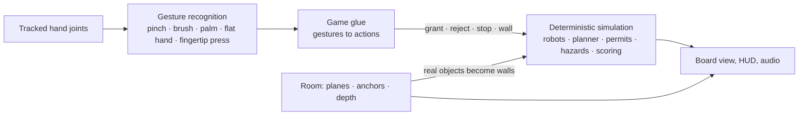

```
src/
  core/        Pure TypeScript simulation, no rendering: deterministic and unit-tested
    game.ts      Robots' state machine, authority (permits, stops, rules), hazards, scoring
    planner.ts   A* routing with space-time reservations so cleared robots never collide
    daily.ts     Daily Shift generator    overtime.ts  Endless mode    crew.ts  Crew memory
  levels/      Level JSON files and validator
  game/        Glue between the simulation and the XR world (actions, coach, progress, gesture log)
  xr/          Rendering and input: gestures, fingertip presses, desk scan, anchors, board, HUD, audio
  eval/        Bot players and metrics
  net/         Optional companion-server client (lines, debrief, co-op)
server/        Optional companion server (Docker + Caddy)
tests/         Vitest suites
scripts/       Evaluation, end-to-end hand tests, scripted filming
```

**Design rules the code enforces:**

- **Agents act, the player authorises.** Robots always choose and plan on their own; the player never steers them. A robot only moves after `Game.grant()` consumes a valid, unexpired permit.
- **Stops never wait for the planner.** `Game.stop()` halts immediately and drops the plan; the robot must be cleared again.
- **Traps are real plans.** A shortcut-biased robot plans while ignoring one rule. Granting it causes an incident; rejecting it teaches that robot to plan honestly for that task.
- **Deterministic.** The same level seed and the same inputs give the same outcome, so levels are testable and the Daily Shift is fair.
- **Works offline.** No account or server is needed; the optional online extras fail quietly.
- **Performance first.** The game requests 72 Hz, and a frame-rate guard steps down decorative effects if the headset falls behind.

## Testing and evaluation

- **Unit and simulation tests** (`npm test`, Vitest): planner, authority rules, gold permits, crew memory, saved-data recovery, gesture detection, fingertip presses and co-op validation.
- **End-to-end hand tests** (`npm run test:hands`, Playwright): emulated hands perform every gesture against the real built game.
- **Difficulty bands** (`npm run eval`): every level is played by three bot players.

| Metric | What it tells us | Target |
| --- | --- | --- |
| Careful player result | The level is winnable with good judgement | Win, 3 stars |
| Careless player result | Approving everything is punished | Lose, or under 3 stars |
| Novice win rate (40 runs) | Difficulty for a first-timer: human reaction delays, misses 30% of shortcuts and 25% of stops | L1 ≥90%, L2 70–95%, L3 50–80%, L4 45–80%, L5 60–90%, L6 50–85%, L7 45–80% |
| Pressure | Share of novice play time with 2+ robots asking at once | ≥15% from level 3 |
| Decisions per minute | How busy the player is | Rises across levels |
| Trust calibration | Over-trust (risky approved, worker incidents) against under-trust (safe plans blocked, needless stops) | Careful play scores "calibrated" |
| Delegation (gold modes) | Gold given only to trustworthy robots, against gold given to anyone, over the same seeds | Wise delivers more; only naive lets shortcuts through |

The bands are enforced by `tests/difficulty.test.ts`, so a level edit that breaks the difficulty curve fails the tests. The Daily Shift generator only accepts a level if the careful bot gets 3 stars, the careless bot cannot, and novices win 4–9 of 10 runs.

## Developer tools

<details>
<summary><b>Tuning on a headset (<code>?debug</code>)</b></summary>

Open the game with `?debug` to see a live panel of pinch distance, palm angle, flick speed and frame rate next to the board. The game keeps a gesture report on the device: what fired, what nearly fired, measured pinch gaps, flick speeds, palm angles, frame rate, and how much of the shift had hands tracked or a controller awake. After playing, come back to the page (still with `?debug`) and press **Copy test report**. The report never leaves the device unless it is copied.

</details>

<details>
<summary><b>Filming without a headset</b></summary>

`node scripts/film.cjs [scene ...]` (with `npm run preview` running, Playwright and ffmpeg installed) records scripted scenes in the emulator: `firstPermit`, `flick`, `palmStop`, `handWall`, `gold`. A shim advances each frame by exactly 1/30 s however slowly the machine renders. Output is `film/<scene>.mp4` at 1280×720 (set `W` and `H` for other sizes). Add `&nocontrols` to hide the emulator controls, and `&occluders` to see the headset's hand cut-outs. Label emulator footage as such.

</details>

## Online extras (optional)

The game is complete offline. A small companion server in `server/` adds two things, and the game falls back silently if it is unreachable:

- **Fresh crew lines and a shift debrief** from Muse Spark Open (Meta's open-weight model, served by Baseten). Play never waits for either, and lines that carry gameplay facts stay written by hand.
- **Play together:** two players, one warehouse. The host opens a room and reads out a 4-letter code; the partner joins with it. Each player sees the other's hands as blue ghost points over the board.

Set `VITE_CLEARANCE_SERVER=https://your-server` when building, or test with `?server=https://your-server`. Without it, the Play together button is hidden and robots use their written lines.

<details>
<summary><b>Run the server</b></summary>

On any small Linux host with Docker, copy `server/deploy/.env.example` to `server/deploy/.env`, fill in `DOMAIN` (for example `51-15-1-2.sslip.io` for IP 51.15.1.2) and `BASETEN_API_KEY`, then from `server/deploy` run `docker compose up -d --build`. Caddy gets the HTTPS certificate. `GET /health` reports whether the model key is set. The `.env` file is git-ignored.

</details>

## Status

Working: the core simulation, campaign levels 1–7, Daily Shift, Overtime, standing clearance, crew memory, desk anchoring, depth walls, spatial sound, the desktop preview and the landing page.

Played on a Meta Quest 3 in passthrough in November 2026. Fixes from those sessions are in: fingertips press only the nearest button, stop buttons need a closer touch, end cards say why a shift was lost, louder audio, and a hint when a controller is keeping hand tracking off. Formal hardware measurements (frame lows, thermals) are tracked in the [headset acceptance sheet](docs/HEADSET-TEST.md).

Submission materials: [form copy and release checklist](docs/SUBMISSION.md) and [video script](docs/VIDEO-SCRIPT.md).

## Author

Built by **Othniel Obasi**. All rights reserved (see `package.json`). Hand poses for the ghost-hand tutorial come from the MIT-licensed pose library of Meta's Immersive Web Emulation Runtime.
